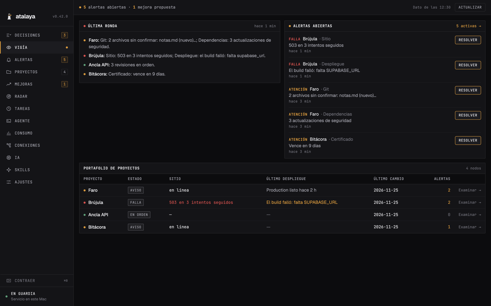
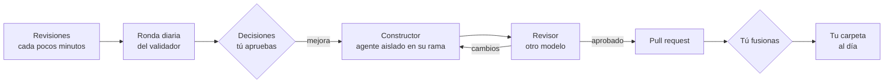
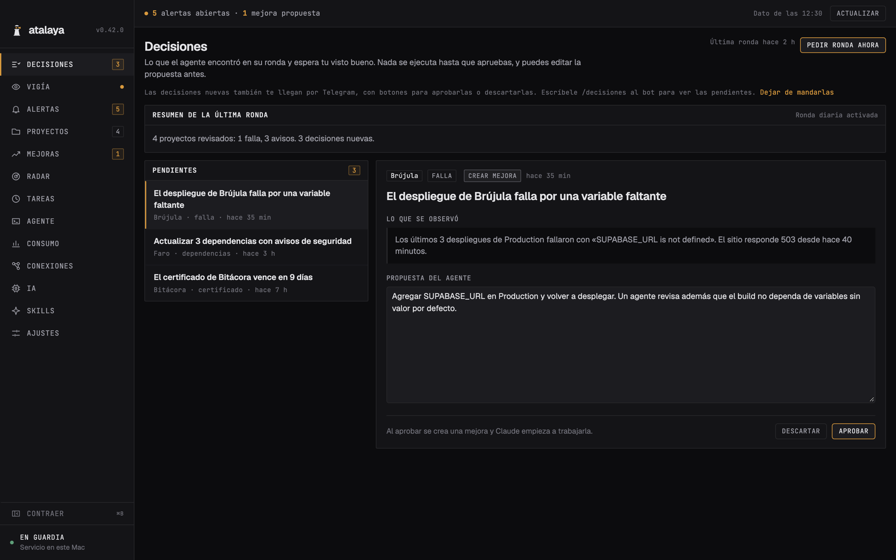
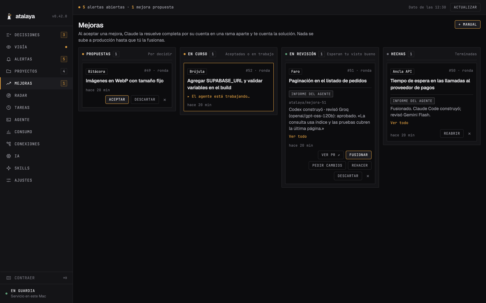
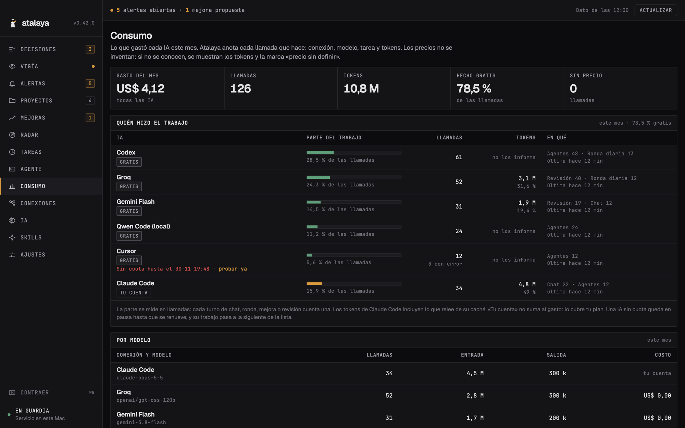

<div align="center">


# Atalaya

**La torre de vigía de tus proyectos de software.**<br/>
Revisa tus sitios, despliegues, bases y repos; te avisa cuando algo falla, y pone a varias IA
a trabajar en las mejoras, siempre con tu visto bueno.

[](CHANGELOG.md)
[](INSTALAR.md)
[](crates/atalaya-core)
[](app)
[](LICENSE)
[](CONTRIBUTING.md)

[Instalar](INSTALAR.md) · [Cómo funciona](#cómo-funciona) · [IA compatibles](#ia-compatibles) · [Arquitectura](docs/ARQUITECTURA.md) · [Colaborar](CONTRIBUTING.md)

<br/>



</div>

## Qué es

Atalaya es una consola para macOS que cuida tus proyectos mientras trabajas en otra cosa. Corre
en tu Mac, sin servidores intermedios: las llaves viven en el Llavero y los datos, en una base
local.

Tres ideas la guían:

- **Nada pasa sin ti.** La IA propone; tú apruebas. Los cambios llegan como pull request y
  fusionarlos es tu decisión.
- **Muchas IA, un solo equipo.** Codex construye, Groq revisa, Gemini responde en el chat,
  Claude Code coordina. Si una se queda sin cuota, el trabajo pasa a la siguiente.
- **Lo gratis primero.** Atalaya sabe qué IA tienes gratis y las pone adelante. Anota cada
  llamada y no inventa precios.

## Lo que hace

| | |
|---|---|
| 🛰️ **Vigila** | Sitios, certificados, despliegues, migraciones, bases de datos, servidores, repos y dependencias. Cada revisión corre sola, con la frecuencia que le corresponde. |
| 🔔 **Avisa** | Notificaciones del Mac, correo y Telegram. Solo avisa lo nuevo, y cada aviso abre la vista que importa. |
| 🧭 **Propone** | Una ronda diaria lee las revisiones y deja **decisiones** concretas: qué se observó y qué propone hacer. Las apruebas desde la app o desde Telegram. |
| 🛠️ **Construye** | Una mejora aprobada la trabaja un agente en una copia aparte y en su propia rama. Otro modelo la revisa y Atalaya abre el pull request. |
| 💬 **Conversa** | Un chat con Claude Code que conoce tus proyectos, pide permiso antes de cada cambio y puede repartir consultas entre tus demás IA. |
| 📊 **Cuenta** | Quién hizo qué, cuántos tokens usó, cuánto costó, presupuestos por IA y un tope por encargo. |
| 🔐 **Protege** | Revisa secretos antes de subir cada rama, aísla a los agentes con `sandbox-exec` y nunca lee sus credenciales. |
| 🔄 **Ordena** | Pone al día tu carpeta local tras fusionar, sin pisar lo que tienes sin confirmar. |

## Cómo funciona



Cada rol (constructor, revisor, validador y asistente) tiene una lista ordenada de IA y una
estrategia: la primera disponible, la más barata, rotar o «gratis primero». Si una falla, pasó
su presupuesto o se quedó sin cuota, Atalaya sigue con la próxima.

<table>
  <tr>
    <td width="50%"></td>
    <td width="50%"></td>
  </tr>
  <tr>
    <td align="center"><sub><b>Decisiones</b>: qué se observó, qué se propone y tu visto bueno.</sub></td>
    <td align="center"><sub><b>Mejoras</b>: de la propuesta al pull request, con la revisión cruzada.</sub></td>
  </tr>
</table>


<p align="center"><sub><b>Consumo</b>: cuánto trabajó cada IA, cuánto fue gratis y cuál está en pausa por falta de cuota.</sub></p>

## IA compatibles

**Agentes de terminal** (cambian código, cada uno encerrado en su copia):
Claude Code · Codex · Antigravity CLI · Gemini CLI · Cursor · GitHub Copilot · Qwen Code ·
Kimi Code · OpenCode · Factory Droid · Amp · o uno propio con plantilla de comando.

**Modelos por API**: Anthropic · OpenAI · Google Gemini · y cualquier servicio compatible con
OpenAI, con preajustes para OpenRouter, Groq, Mistral, SambaNova, Cloudflare Workers AI, NVIDIA,
Z.ai, DeepSeek, xAI, Kimi, Qwen, MiniMax, Together, Fireworks, Cerebras, Perplexity, Hugging Face,
Vercel AI Gateway y Cohere.

**En tu Mac, sin costo**: Ollama · LM Studio · Jan · llama.cpp. Qwen Code puede usar uno de
estos modelos (o una API gratis como Groq) para construir sin gastar.

## Servicios que vigila

| Tipo | Proveedores |
|---|---|
| Código | GitHub · GitLab · Gitea / Forgejo · solo local |
| Hosting | Vercel · Netlify · servidor propio (URL de salud y SSH opcional) |
| Bases de datos | Supabase · Firebase · PostgreSQL · MySQL / MariaDB · SQLite |
| Avisos | Notificaciones de macOS · correo SMTP · Telegram |

Puedes tener varias conexiones del mismo tipo, y cada proyecto elige las suyas.

## Empezar

Atalaya se compila en tu Mac. Necesitas Rust estable, Node 20 o más nuevo y las herramientas de
línea de comandos de Xcode.

```bash
git clone https://github.com/Thrazos360/Atalaya.git
```

```bash
cd Atalaya && scripts/crear-firma.sh && scripts/build-pkg.sh
```

El instalador queda en `dist/`. Al abrirlo por primera vez, macOS lo bloquea porque no viene
firmado por Apple: ábrelo desde **Ajustes del Sistema → Privacidad y seguridad → Abrir
igualmente**. La guía completa, con el primer uso paso a paso, está en
[INSTALAR.md](INSTALAR.md).

Para probar sin tocar una instalación real, o para entender el código antes de cambiarlo, lee
[docs/ARQUITECTURA.md](docs/ARQUITECTURA.md).

## Privacidad y seguridad

- Corre en tu Mac. Atalaya no tiene servidor propio ni telemetría: solo habla con los
  servicios que tú conectas.
- Las llaves viven en el Llavero de macOS. La interfaz nunca las recibe de vuelta.
- Los agentes trabajan en un `git worktree` aparte, dentro de `sandbox-exec`: no ven
  `~/.ssh`, `~/.aws` ni las credenciales de git, y no pueden hacer `git push`.
- El revisor nunca es el mismo modelo que construyó.
- Ningún cambio llega a producción sin que tú fusiones el pull request.

## Colaborar

Atalaya está en desarrollo activo (versión 0.x) y las ideas son bienvenidas. Algunas formas de
sumarte:

- **Prueba y cuenta.** Abre un [issue](https://github.com/Thrazos360/Atalaya/issues) con lo que
  te funcionó, lo que no y lo que echas de menos.
- **Agrega un proveedor.** Un servicio compatible con OpenAI es una línea en `API_PRESETS`; un
  agente nuevo, una entrada en `clis::CATALOG`. La receta está en
  [docs/ARQUITECTURA.md](docs/ARQUITECTURA.md#agregar-un-proveedor).
- **Mejora la interfaz.** React + TypeScript en `app/src`.

Antes de abrir un pull request, lee [CONTRIBUTING.md](CONTRIBUTING.md). Los cambios de cada
versión están en [CHANGELOG.md](CHANGELOG.md).

## Licencia

[MIT](LICENSE): puedes usarlo, modificarlo y compartirlo, manteniendo el aviso de autoría.

<div align="center">
<br/>
<sub>Hecho con Rust, Tauri y muchas IA trabajando en equipo.</sub>
</div>
